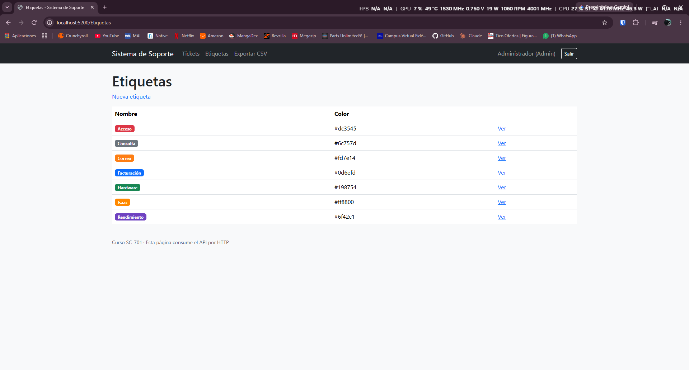
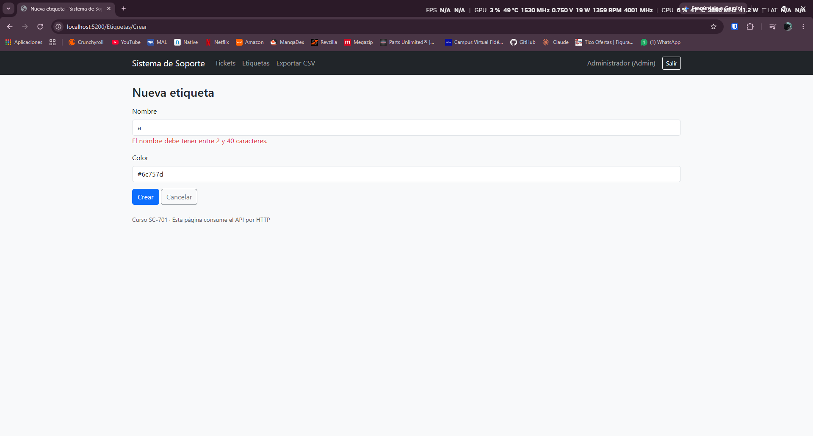
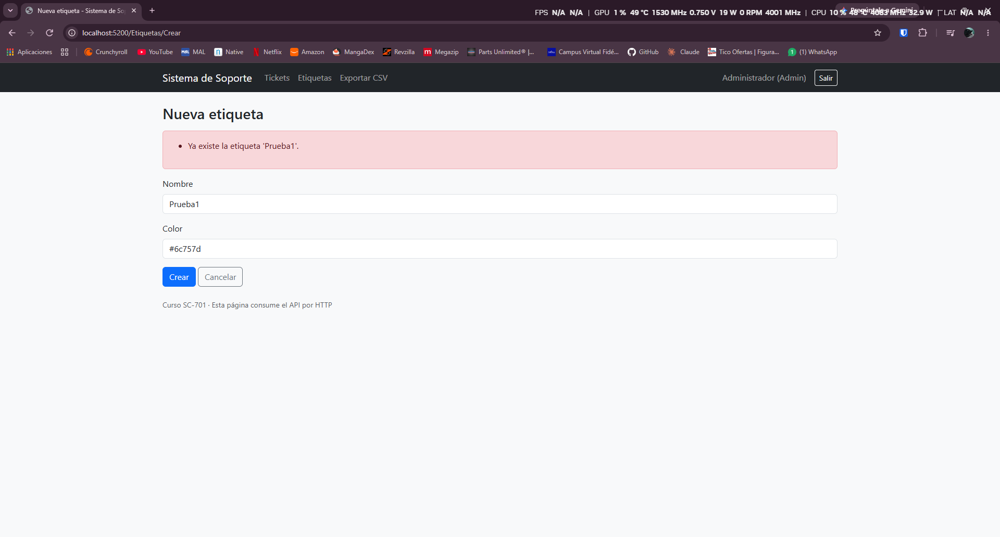
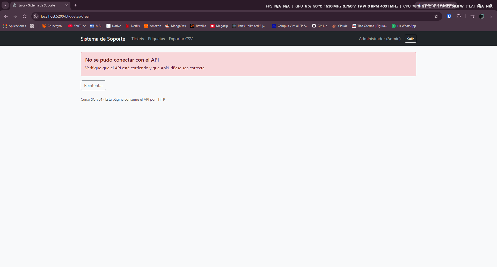

1. ¿Qué es el patrón Post-Redirect-Get y qué problema concreto evita? Explíquelo con lo que
pasaría si lo omite y el usuario presiona F5.
    Es un patron de diseño que evita enviar un formulario por segunda vez al recargar la pagina.
    Funciona al redirigir a otra pagina cuando se hace el primer POST, dejando al usuario en un GET.
    Si se omite el usuario cada vez que presiona F5 repetiria el metodo POST
    

2. El cliente tipado se registra con AddHttpClient<TInterfaz, TImplementacion> . ¿Qué tiempo
de vida (Transient, Scoped o Singleton) tiene y por qué no conviene que sea Singleton ni
crear new HttpClient() a mano?

3. ¿Qué es ProblemDetails (RFC 9457)? Nombre los campos que su MVC lee y diga cuál es la
diferencia entre el formato de un 400 de validación y el de un 409.

4. ¿Qué ataque previene [ValidateAntiForgeryToken] ? Explique cómo lo hace ASP.NET Core y
qué se pone en el formulario.
    Previene un ataque CSRF (Cross-Site Request Forgery), este ataque utiliza la credencial que guarda el navegador 
    para enviar otro formulario o codigo de otra pagina.

5. Compare ViewData , ViewBag , TempData y un modelo tipado: ¿cuándo usaría cada uno? Dé un
ejemplo de su propia práctica.

Referencias

Evidencias

1. Lista de etiquetas con la vista parcial _InsigniaColor funcionando.

   

2. Formulario con error de validación bajo el campo Nombre (nombre de 1 letra).

   

3. Formulario con el mensaje de nombre repetido (409) al crear dos veces "Prueba1".

   

4. (Extra) Con el API apagado se muestra la página de error del filtro.

   

Declaracion de uso de herramientas
Se uso claude code para revisar, guiar y corregir el codigo. Asi como explicar partes que no se entendieron.
Tambien se uso para configurar los secretos locales del API (Jwt:Clave y Semilla:ClaveInicial) y correr la semilla,
corregir el controlador de la lista y la carpeta de vistas, y escribir la accion y vista Detalle, la vista parcial
_InsigniaColor y el enlace "Etiquetas" del menu. 